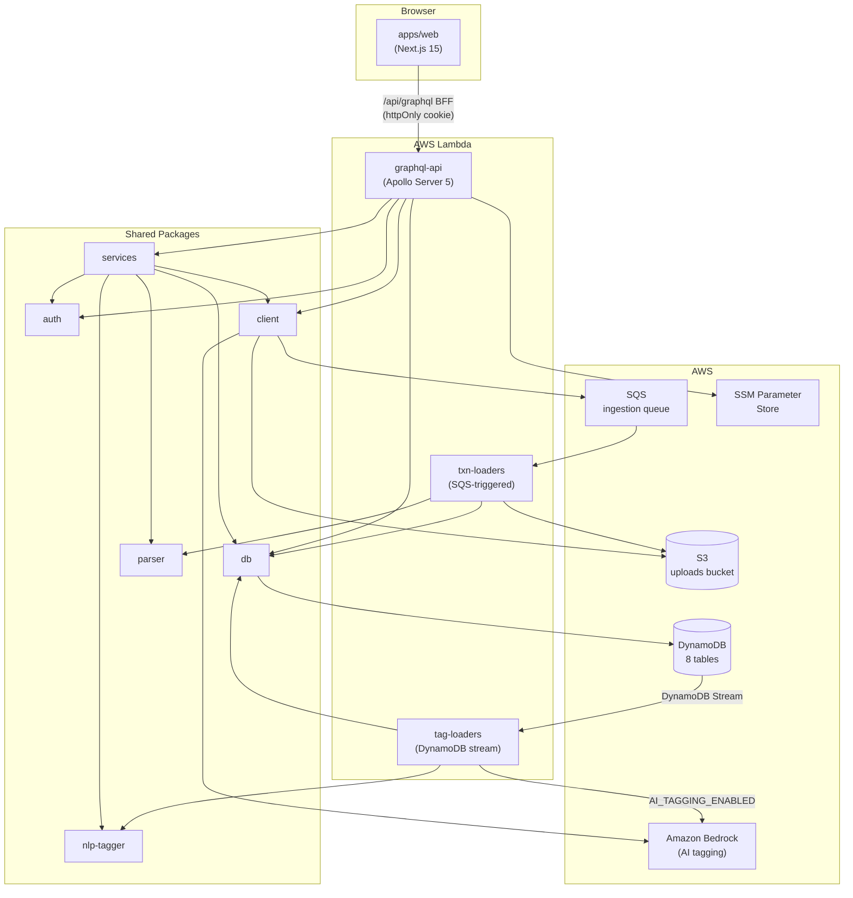
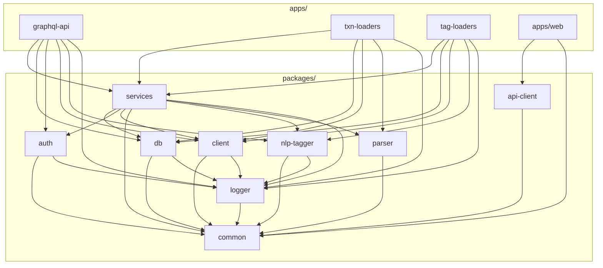
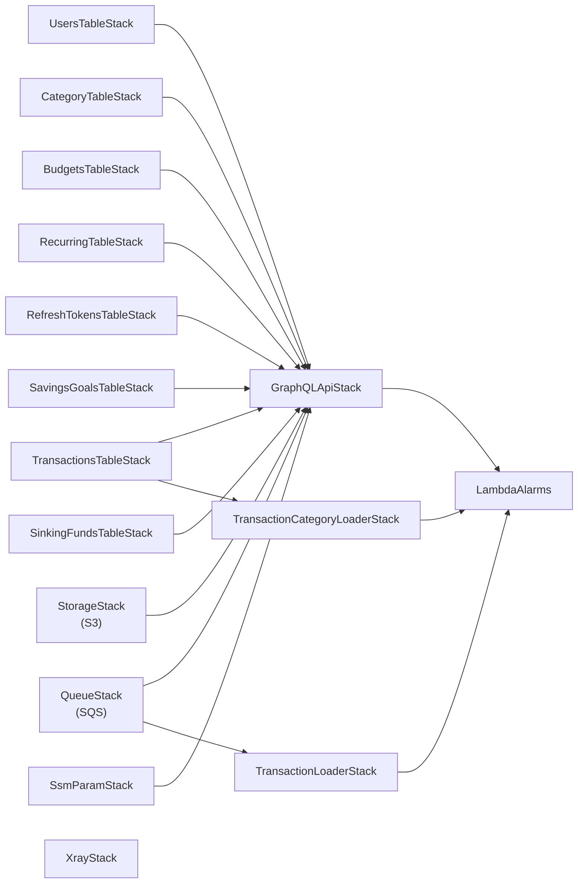
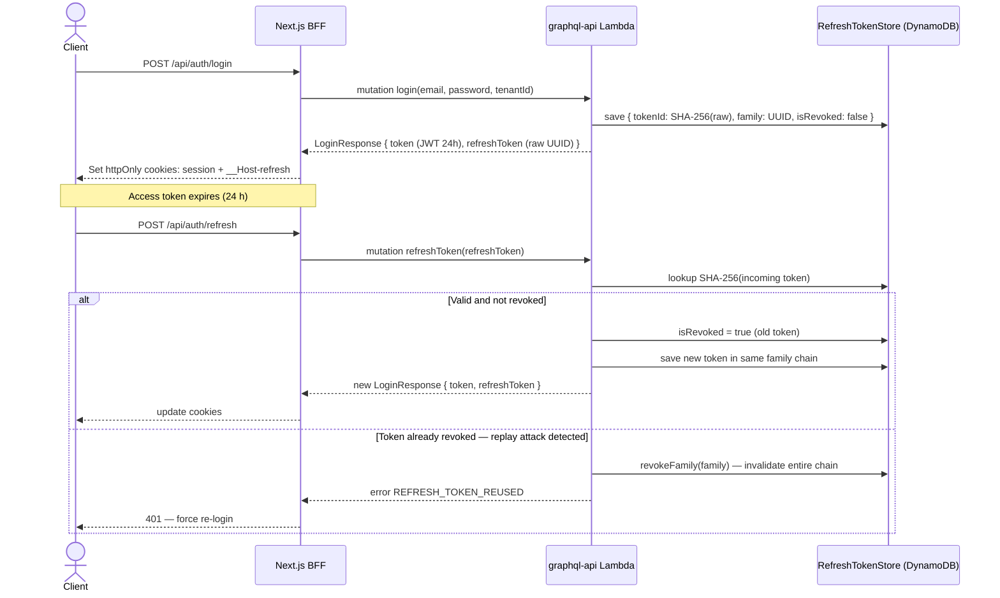
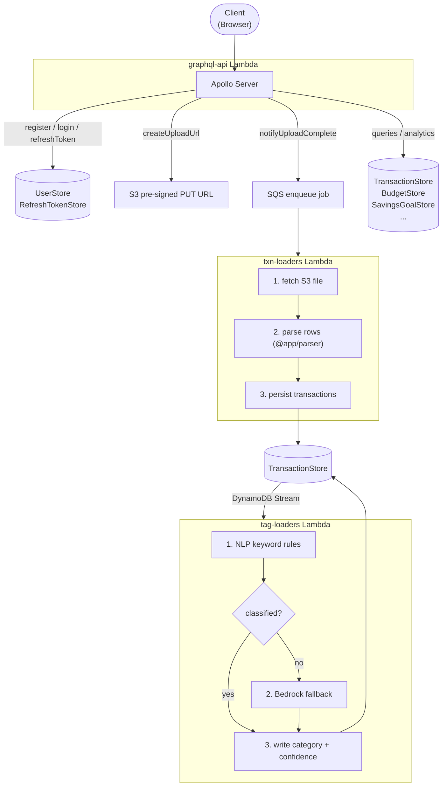
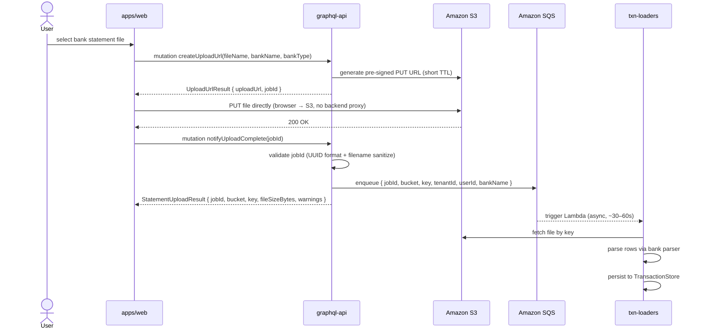
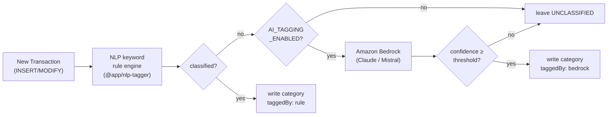

# Architecture

## Overview

Full Budget App is a multi-tenant, serverless budgeting platform that ingests raw bank statements, enriches transactions with AI-assisted or rule-based categorization, and exposes a GraphQL API for dashboards and automations. The monorepo is managed with pnpm workspaces so application code, shared services, and infrastructure definitions can evolve together while staying deployable as independent AWS Lambda functions.

Key principles:

- **Serverless first** — Lambda, DynamoDB, S3, and SQS supply elastic scale without maintaining servers.
- **AWS-native** — Lambda, DynamoDB, S3, SQS, and Parameter Store; deploy against the real AWS environment.
- **SDL as source of truth** — `docs/finance-budget.sdl.graphql` drives the schema. Every change flows SDL → typeDefs → resolvers → services; resolvers contain no business logic.
- **Shared domain services** — Business logic (budgets, categorization, savings, recurring transactions) lives in `packages/services` and is imported by any runtime needing the functionality.
- **Tenant isolation** — Every store method takes `(tenantId, userId)`; request context carries tenant metadata so data access and logging remain scoped per tenant.
- **AI assist, deterministic core** — Keyword rules classify transactions first; Amazon Bedrock is only invoked for unclassified records or when extra signal is desired.

### System Topology



---

## Runtime Services (`apps/`)

### `graphql-api`

Apollo Server 5 running on Lambda (Express for local dev). Responsibilities:

- Resolves all GraphQL queries and mutations by delegating to `packages/services` — resolvers are intentionally thin.
- Wires multi-tenant auth context: decodes the JWT from the `Authorization` header, attaches `tenantId`, `userId`, and `email` to every operation.
- Handles the two-step upload flow: `createUploadUrl` (pre-signed S3 PUT) and `notifyUploadComplete` (confirms receipt, enqueues SQS job, returns `StatementUploadResult`).
- Exposes `/metrics` for Prometheus scraping; extend counters/histograms under `apps/graphql-api/src/utils`.
- Schema is built with `@graphql-tools/schema` from the SDL file and a `Date` scalar backed by a V8-safe calendar validator.

### `txn-loaders`

SQS-triggered Lambda that processes statement ingestion jobs:

1. Reads the SQS message to locate the tenant, user, bank, and S3 key.
2. Fetches the raw file from S3.
3. Parses rows into canonical `ITransaction` objects via the bank-specific parser from `@app/parser`.
4. Persists transactions through `TransactionStore` in `@app/db`.

### `tag-loaders`

DynamoDB stream-driven Lambda subscribed to the transactions table:

1. Receives INSERT/MODIFY events from the DynamoDB stream.
2. Runs the deterministic keyword rule engine from `@app/nlp-tagger`.
3. When a record remains `UNCLASSIFIED` and `AI_TAGGING_ENABLED=true`, calls `BedrockClassifierService`.
4. Writes the enriched `category`, `taggedBy`, and `confidence` back to DynamoDB.

Each service bundles with esbuild (`--target=node24`) for fast cold starts and provides a `dev` script powered by `ts-node-dev` for local iteration.

---

## Shared Packages (`packages/`)

### Package Dependency Graph



### `services`

Domain orchestrators — the only place business logic lives:

| Service | Responsibility |
|---------|----------------|
| `AuthorizationService` | Register, login, refresh-token rotation with family revocation |
| `UploadUrlService` | Issue pre-signed S3 PUT URLs; `notifyUploadComplete` validates job ID, triggers SQS, returns `IStatementUploadResult` |
| `UploadStatementService` | Legacy single-step upload; returns `IStatementUploadResult` with 8 MB size warning |
| `TransactionService` | Ingestion pipeline, analytics (monthly/annual review, aggregates, forecasts) |
| `TransactionCategoryService` | Apply and manage category rules |
| `BudgetService` | Create, update, delete, and query budget entries |
| `RecurringTransactionService` | Define recurring templates and materialize entries for a given period |
| `SavingsGoalService` | CRUD + contribution tracking for savings goals |
| `SinkingFundService` | CRUD + contribution tracking for sinking funds |
| `BedrockClassifierService` | Invoke Amazon Bedrock with a structured prompt; parse category/confidence from the response |
| `ForecastService` | Project daily cash flow and emit typed `ForecastAlert` entries |

Constructor injection pattern — every service receives `(logger, ...stores)` via `setup-services.ts` in `graphql-api`.

### `auth`

JWT signing/verification, bcrypt password hashing, and refresh-token primitives:

- `signToken(payload, secret)` / `verifyToken(token, secret)` — thin wrappers over `jsonwebtoken`.
- `hashPassword(plain)` / `comparePassword(plain, hash)` — bcrypt helpers.
- `generateRefreshToken()` — returns a cryptographically random `UUID v4` (raw, never stored).
- `hashRefreshToken(raw)` — SHA-256 hex digest used as the DynamoDB primary key so the raw token never touches storage.

### `client`

Typed AWS SDK wrappers:

- `S3Service` — `getObject`, `putObject`, `getSignedUploadUrl` (via `@aws-sdk/s3-request-presigner`).
- `SqsService` — `sendMessage`, `receiveMessages`, `deleteMessage`.
- `BedrockRuntimeService` — `invokeModel` with structured prompt/response handling.

### `common`

Shared contracts consumed by every other package:

- **Domain interfaces** — `ITransaction`, `IUser`, `IBudget`, `IRecurringTransaction`, `ISavingsGoal`, `ISinkingFund`, `IRefreshToken`, `IStatementUploadResult`.
- **Store interfaces** — `IUserStore`, `ITransactionStore`, `IBudgetStore`, `IRefreshTokenStore`, `ISavingsGoalStore`, `ISinkingFundStore`, `IUploadUrlService`, `IS3Service`.
- **Enums** — `ETenantType`, `EBankName`, `EBaseCategory`, `ETransactionType` (`CREDIT` / `DEBIT`), `EForecastAlertType` (`OVER_BUDGET`, `UNUSUAL_SPIKE`, `SAVING_TARGET_RISK`, `HIGH_DISCRETIONARY`, `INCOME_DROP`).
- **Utilities** — `inferTransactionType(credit, debit): ETransactionType`.

### `db`

DynamoDB repositories. Access pattern: `PK = tenantId`, `SK = id` (or composite SK for time-series).

| Store | Table | Notable features |
|-------|-------|-----------------|
| `UserStore` | `DYNAMO_USER_TABLE` | Email lookup by tenantId |
| `TransactionStore` | `DYNAMO_TRANSACTION_TABLE` | Month-range GSI for analytics; stream enabled |
| `CategoryRulesStore` | `DYNAMO_CATEGORY_RULES_TABLE` | Keyword → BaseCategory rules per tenant |
| `BudgetStore` | `DYNAMO_BUDGET_TABLE` | Period (year/month) GSI |
| `RecurringTransactionStore` | `DYNAMO_RECURRING_TABLE` | Active/inactive filter |
| `RefreshTokenStore` | `DYNAMO_REFRESH_TOKENS_TABLE` | PK = SHA-256(token); FamilyIndex GSI for family revocation |
| `SavingsGoalStore` | `DYNAMO_SAVINGS_GOAL_TABLE` | Ownership guard (`userId#` prefix check); history seeding on create |
| `SinkingFundStore` | `DYNAMO_SINKING_FUND_TABLE` | Ownership guard; contribution history |

### `parser`

Stateless, side-effect-free parsers. Each implements `IStatementParser`:

- `HdfcCsvParser` — HDFC savings/current account CSV export.
- `SbiCsvParser` — SBI account CSV export.
- `AxisCreditCardParser` — Axis Bank credit card PDF/CSV.
- `HdfcCreditCardParser` — HDFC credit card statement.

`txn-loaders` selects the correct parser based on the `bankName` field in the SQS message.

### `nlp-tagger`

Deterministic keyword tagging rules:

- `RuleStore` — in-memory store of `{ keyword, category, subCategory, confidence }` rules loaded from DynamoDB at cold start.
- `NlpTagger` — scans the transaction description against all rules, returns the highest-confidence match.
- Rules are editable at runtime via `addTransactionCategory` GraphQL mutation.

### `logger`

Winston-based logger injected via the `ILogger` interface. Emits JSON in production, pretty-prints in development. Every service receives the logger through DI — no global singletons.

---

## Infrastructure (`infra/`)

All CDK stacks use on-demand DynamoDB capacity and arm64 Lambda architecture where applicable.

### Stacks

| Stack | Resources |
|-------|-----------|
| `StorageStack` | S3 bucket for statement uploads |
| `QueueStack` | SQS queue for ingestion jobs + DLQ |
| `UsersTableStack` | `users` DynamoDB table |
| `TransactionsTableStack` | `transactions` table with stream + month GSI |
| `TransactionCategoryTableStack` | `categories` table |
| `BudgetsTableStack` | `budgets` table |
| `RecurringTransactionsTableStack` | `recurring-transactions` table |
| `RefreshTokensTableStack` | `refresh-tokens` table with FamilyIndex GSI |
| `SavingsGoalsTableStack` | `savings-goals` table |
| `SinkingFundsTableStack` | `sinking-funds` table |
| `TransactionLoaderStack` | `txn-loaders` Lambda wired to SQS event source |
| `TransactionCategoryLoaderStack` | `tag-loaders` Lambda wired to transactions stream |
| `GraphQLApiStack` | `graphql-api` Lambda + Function URL |
| `SsmParamStack` | JWT secret and feature flags in Parameter Store |
| `LambdaAlarmsConstruct` | CloudWatch alarms for errors/throttles |
| `XrayStack` | X-Ray sampling rule and group |

### CDK Stack Dependency Graph



---

## Security Model

### Authentication & Refresh-Token Rotation



- Access tokens are short-lived JWTs (signed with `JWT_SECRET` from SSM).
- Raw refresh tokens are **never** stored — only the SHA-256 hex digest is written to DynamoDB.
- `expiresAt` (ISO string) and `ttl` (DynamoDB TTL epoch) provide automatic cleanup.

### Multi-tenancy

- Every DynamoDB store method accepts `(tenantId, userId)` and scopes all reads/writes to that tenant.
- Ownership guards in `SavingsGoalStore` and `SinkingFundStore` verify the stored item's SK begins with `userId#` before allowing mutations.
- No cross-tenant data can be returned; resolvers surface only what the decoded JWT authorizes.

### Upload Security

- Pre-signed S3 URLs are issued per-request with a short TTL. The `jobId` is a validated UUID before `notifyUploadComplete` proceeds.
- Filenames are sanitized (`..+` → `_`, `/\` → `_`) to prevent path-traversal attacks.
- Files larger than 8 MB emit a warning in `StatementUploadResult.warnings[]` but are not rejected.

---

## GraphQL Schema Design

The SDL (`docs/finance-budget.sdl.graphql`) is the single source of truth:

- **`scalar Date`** — ISO-8601 calendar strings (`YYYY-MM-DD`). Validated at parse time with a V8-safe UTC component round-trip: `Date.UTC(y, m-1, d)` is decomposed and compared back to prevent silent rollover (e.g., `2024-02-30` → March 1).
- **`TransactionType`** enum — `CREDIT` / `DEBIT` on `RecurringTransaction.type` and `Transaction.type`. Derived automatically by `inferTransactionType(credit, debit)`.
- **`EForecastAlertType`** enum — Typed alert categories on `ForecastAlert.type`: `OVER_BUDGET`, `UNUSUAL_SPIKE`, `SAVING_TARGET_RISK`, `HIGH_DISCRETIONARY`, `INCOME_DROP`.
- **`TransactionsPage`** — Cursor-based pagination used by `Query.annualReview` and `Query.transactions`. Cursor is a base64-encoded `txnDate|id` string; `PAGE_SIZE = 20`.
- **`StatementUploadResult`** — Rich upload response carrying `jobId`, `bucket`, `key`, `fileSizeBytes`, and `warnings[]`.
- **`LoginResponse.refreshToken`** — Opaque string (raw UUID); the hashed form lives only in DynamoDB.
- **Deprecated** — `uploadStatement` is deprecated in favor of `createUploadUrl` + `notifyUploadComplete`.

---

## Data Flow

### End-to-End Request Flow



### Two-Step Upload Flow



---

## AI-Assisted Categorization



- **Rule engine first** — `TransactionCategoryService` executes deterministic keyword rules stored per-tenant in `CategoryRulesStore`. This keeps behavior explainable and avoids unnecessary AI calls.
- **Bedrock fallback** — When a transaction remains `UNCLASSIFIED`, `BedrockClassifierService` invokes the configured model (default: `anthropic.claude-3-haiku-20240307-v1:0`) via `@app/client`.
- **Confidence hints** — Responses include a suggested category, reasoning, and confidence score. Consumers can enforce thresholds via `AI_CONFIDENCE_THRESHOLD`.
- **Feature flag** — `AI_TAGGING_ENABLED` controls whether the Bedrock step runs per environment.

---

## Observability & Operations

| Concern | Mechanism |
|---------|-----------|
| Structured logging | `@app/logger` (Winston) injected into every service; includes `tenantId`, `requestId`, and correlation metadata |
| Metrics | `/metrics` endpoint on `graphql-api`; extend counters/histograms under `apps/graphql-api/src/utils` |
| Distributed tracing | Active X-Ray on all Lambdas; sampling rate 5%; rule + group provisioned by `XrayStack` |
| Alarms | CloudWatch alarms for Lambda errors and throttles in `LambdaAlarmsConstruct` |
| DLQ | SQS dead-letter queue captures failed ingestion jobs for replay |
| Log retention | 7 days (`ONE_WEEK`) on all Lambda log groups via `logRetention` CDK property |
| Configuration | Runtime config from `.env`, SSM Parameter Store, and feature flags injected at deploy time |

---

## Dependency Management

The workspace uses a **root-centric devDependency** model:

- All `devDependencies` (TypeScript, Jest, ESLint, Prettier, type stubs) live in the root `package.json` and are shared across all packages.
- Individual packages declare only their runtime `dependencies`.
- AWS SDK versions are pinned to `^3.873.0` across all packages to prevent duplicate installations.
- `pnpm.overrides` forces a single version of `@smithy/*` packages to resolve the transitive conflict introduced by `aws-cdk-lib`.

---

## Workspace Layout

```
full-budget-app/
├── apps/
│   ├── graphql-api/        Apollo Server Lambda
│   ├── txn-loaders/        SQS ingestion Lambda
│   ├── tag-loaders/        DynamoDB stream Lambda
│   └── web/                Next.js 15 frontend
├── packages/
│   ├── api-client/         GraphQL codegen output + typed hooks
│   ├── auth/               JWT + bcrypt + refresh-token primitives
│   ├── client/             AWS SDK wrappers (S3, SQS, Bedrock)
│   ├── common/             DTOs, interfaces, enums, utilities
│   ├── db/                 DynamoDB store implementations
│   ├── logger/             Winston logger
│   ├── nlp-tagger/         Keyword tagging rules
│   ├── parser/             Bank statement parsers
│   └── services/           Domain service orchestrators
├── infra/
│   ├── bin/infra.ts        CDK app entry point
│   └── lib/                CDK stacks and constructs
├── docs/
│   ├── ARCHITECTURE.md     This document
│   └── finance-budget.sdl.graphql   Canonical GraphQL SDL
├── scripts/                One-off migration and seed scripts
├── artifacts/              Sample training data
├── tsconfig.json           Root TypeScript config (extended by all packages)
├── package.json            Root devDependencies + pnpm workspace config
└── esbuild.config.js       Shared esbuild bundling config
```

---

## Local Development Workflow

- Run `pnpm install` once to hydrate all workspace dependencies.
- Use `pnpm dev` to build packages in watch mode; start individual apps with `pnpm --filter @app/<service> dev`.
- Tests live alongside their packages (`*.spec.ts`). Run `pnpm test`, `pnpm lint`, and `pnpm typecheck` before shipping.
- Deploy with `pnpm deploy:qa` and ensure AWS credentials are set in the environment.
- Postman collections (`docs/postman/`) and sample data (`artifacts/training.csv`) support manual verification.

---

## Extending the Platform

- **Add a bank parser** — implement `IStatementParser` in `packages/parser`, export it from the index, and update the bank-selector in `txn-loaders`.
- **Add a GraphQL operation** — update the SDL first, then `typeDefs`, then the resolver (thin — delegate to a service), then add or extend the service, then write a `*.spec.ts`.
- **Add a DynamoDB table** — create a store in `packages/db`, add a CDK stack in `infra/lib`, wire it in `infra/lib/index.ts` and `apps/graphql-api/src/setup-services.ts`.
- **Add a new service** — follow the DI constructor pattern `(logger: ILogger, ...stores)` and expose the interface in `packages/common`.
- **Expand infrastructure** — author a new construct or stack under `infra/lib` and add it to the `deploy:qa` script.

Refer to `README.md` for environment setup, deployment commands, and contribution guidelines.
